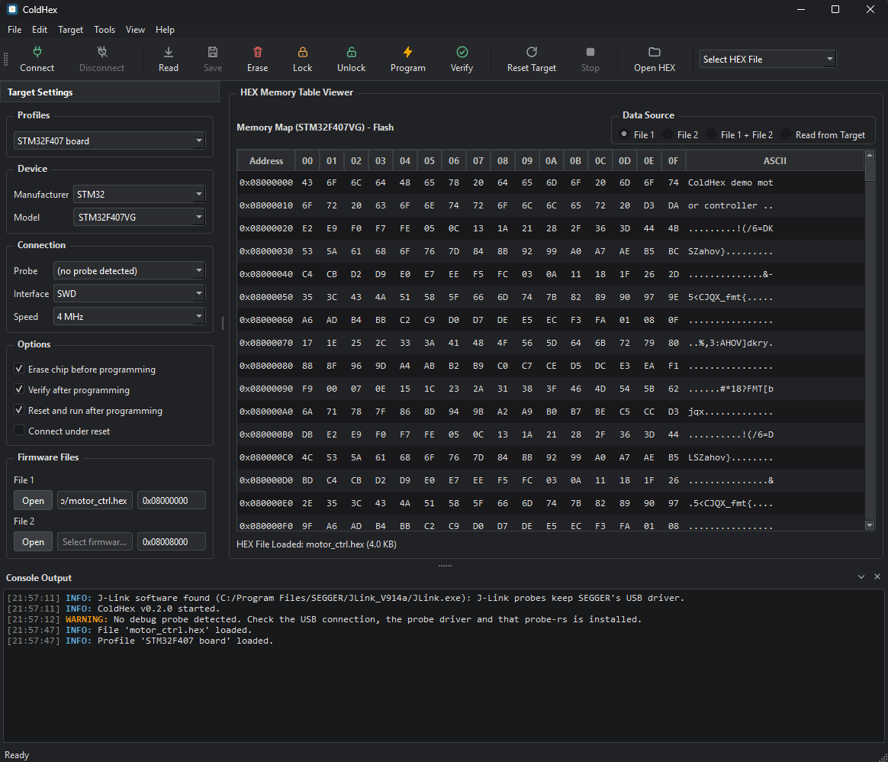

# ColdHex

[](https://github.com/hakanyz/coldhex/actions/workflows/build.yml)
[](LICENSE)

A desktop tool to flash and manage ARM Cortex-M microcontrollers over **ST-Link**, **J-Link** and
**CMSIS-DAP** probes. It is vendor independent: STM32, GD32, Geehy APM32, TI, NXP, Nordic and
every other chip supported by [probe-rs](https://probe.rs), in one window.



> **Status: beta.** The logic is covered by automated tests. Connecting, reading, erasing, programming
> and the progress display were tried on real hardware: ST-Link, J-Link and a CMSIS-DAP probe with an
> STM32F407 and an APM32F407. Lock and Unlock were run on those two boards only; the other chip
> families follow the vendors' own code and have not been tried yet. Please report problems through
> the issue tracker.

## Features

- **Wide chip support** – search more than 4,000 chips while you type; the manufacturer box follows
  your selection. Geehy APM32 (F0, F1, F4) is bundled; other CMSIS-Pack chips can be added.
- **Two firmware slots** – flash a bootloader and an application in one run, each with its own start
  address. Overlaps between the slots and writes outside the chip's flash are refused.
- **Firmware formats** – Intel HEX (checksums are validated), raw binary with a start address, and ELF.
  Drag and drop files onto the window.
- **Full workflow** – Connect, Erase, Program, Verify, Read the flash (it is shown in the memory
  viewer; Save writes it to a file), Reset, and Stop a running operation. Erase / verify / reset
  after programming are optional.
- **Read-out protection** – after connecting, ColdHex shows whether the chip is read-protected (level
  1) and offers to remove it; Lock and Unlock buttons set and clear level 1. Level 2 is never
  written. Chip families without a known method have the buttons greyed out, with the reason in the
  tooltip.
- **Reliable connections** – SWD or JTAG, adjustable speed, *connect under reset*, and an automatic
  speed reduction that resumes the sequence at the step that failed.
- **System Check** – on start-up ColdHex looks for probe-rs, connected probes and their drivers and
  tells you what is missing and how to fix it (Help > System Check).
- **Memory viewer** – inspect a HEX/BIN/ELF file or the data read back from the chip.
- **Self-contained packages** – probe-rs is included, and so are the Qt libraries on Windows (on Ubuntu apt installs them); nothing else to install
  apart from the probe driver on Windows.

## Install

Download the package for your system from the
[Releases](https://github.com/hakanyz/coldhex/releases) page.

| System | File | How |
|---|---|---|
| Windows 10/11 (64-bit) | `coldhex-<version>-win64.exe` | Run the installer |
| Windows 10/11 (64-bit) | `coldhex-<version>-win64.zip` | Unpack anywhere, start `bin\coldhex.exe` |
| Ubuntu 22.04 (64-bit) | `coldhex_<version>_amd64.deb` | `sudo apt install ./coldhex_<version>_amd64.deb` |
| Linux (64-bit) | `coldhex-<version>-Linux.tar.gz` | Unpack, start `usr/bin/coldhex` (needs the Qt 6 libraries) |

ColdHex is 64-bit only: there are no packages for 32-bit Windows or for ARM.

### Probe drivers

| Probe | Windows | Linux |
|---|---|---|
| ST-Link | Install the official ST-LINK USB driver from st.com | Nothing to do – the `.deb` installs the USB rules |
| J-Link | Nothing to do **if SEGGER's J-Link software is installed** (as most Keil users have): ColdHex then drives SEGGER's own `JLink.exe`, the probe keeps SEGGER's driver and Keil keeps working. Without that software probe-rs needs the WinUSB driver (for example installed with [Zadig](https://zadig.akeo.ie)), and SEGGER's own tools no longer find the probe afterwards. | Install SEGGER's J-Link software (`JLinkExe`) for the same behaviour; the `.deb` installs the USB rules |
| CMSIS-DAP | No driver needed | Nothing to do – the `.deb` installs the USB rules |

If a driver is missing, **Help > System Check** says so.

**Speed with a J-Link:** an older or simple J-Link (and long or ungrounded wires) can be unreliable
above a few hundred kHz. Writes then fail with "Verification of RAMCode failed", and reads can come
back shifted by a word without any error. If that happens, set the speed to 100 kHz. ST-Link and
CMSIS-DAP probes did not show this.

## Quick start

1. Connect the probe and the target board.
2. Pick the **Manufacturer** and **Model** (or type part of the chip name).
3. Choose **Interface** and **Speed**, then press **Connect**.
4. Select your firmware in **File 1** and/or **File 2** (for example a bootloader and an application, or files for two different boards). Under **Data Source** choose which one is programmed: **File 1**, **File 2**, or **File 1 + File 2** for both. For
   `.bin` files enter the start address; HEX and ELF files carry their own addresses.
5. Press **Program**.

To switch between boards quickly, save the settings as a profile in the **Profiles** box (top of Target Settings). Hover the selected profile in the list to rename it, save changes to it or delete it. A profile keeps the chip, interface, speed, options, firmware files and Data Source, but not the probe.

## Chips that probe-rs does not know

Generate a chip description from the vendor's CMSIS-Pack with probe-rs'
[`target-gen`](https://github.com/probe-rs/probe-rs/releases) and add it in ColdHex:

```
target-gen pack <vendor>.pack <output-folder>
```

Then use **Tools > Add Chip Description File...**. To ship chips inside your own build, put the
generated `.yaml` files into `resources/chips/` and re-run CMake; they are loaded on every start.

## Building from source

Requirements: a C++17 compiler, CMake 3.16 or newer and Qt 6 (Widgets). The continuous integration
builds with Qt 6.8 on Windows (MinGW) and Qt 6.2 on Ubuntu 22.04.

```
cmake -S . -B build -DCMAKE_BUILD_TYPE=Release
cmake --build build
ctest --test-dir build --output-on-failure
```

The program looks for `probe-rs` next to itself, then on `PATH`. Install it from
[probe.rs](https://probe.rs/docs/getting-started/installation/) when running a local build.

### The coldhex-flash helper (optional, needs Rust)

Erase, program, verify and read show a real percentage in the status bar only when the small Rust helper in
`tools/coldhex-flash` is built. CMake builds it when it finds `cargo` ([rustup.rs](https://rustup.rs))
and puts it next to the program. Without `cargo`, or with `-DCOLDHEX_BUILD_FLASH_HELPER=OFF`, the
same steps run through the probe-rs tool and show only the time they take. On Windows with MinGW
the Rust toolchain `stable-x86_64-pc-windows-gnu` works; the MinGW `bin` folder must be on `PATH`.

### Packages

```
cmake -S . -B build -DCMAKE_BUILD_TYPE=Release -DCOLDHEX_PROBE_RS_DIR=<folder with probe-rs>
cmake --build build
cd build && cpack
```

CPack creates `.zip` and `.exe` on Windows and `.deb` and `.tar.gz` on Linux. The workflow in
`.github/workflows/build.yml` does this for every push; tags that start with `v` are published as
GitHub releases (a tag with a dash, such as `v0.1.0-beta1`, as a pre-release).

## Project layout

```
src/
├── app/        Application entry point
├── ui/         Qt Widgets interface (MainWindow.ui, console, chip and probe selection, dialogs)
├── core/       Flash sequence, firmware parsers, settings, chip catalogue
└── engine/     Engine interface, probe-rs driver, system check
tests/          Unit tests (Qt Test) with a mock engine
resources/      Icons, style sheet, bundled chip descriptions
packaging/      Linux package files, third-party notices
docs/           Demo GIF for this README
```


## Testing

`ctest` runs the automated tests. Before a release, also try the program on real hardware.

## Contributing

Development follows a simple branch model:

- `main` holds released versions only.
- `develop` is the integration branch.
- Work happens in `feature/<name>` branches that start from `develop` and are merged back through a
  pull request.

Please make sure `ctest` passes and describe what you changed and how you tested it.

## License

ColdHex is licensed under the [GNU Lesser General Public License v3.0](LICENSE) (the GPL text it
refers to is in [COPYING](COPYING)). Third-party components – Qt (LGPL v3), probe-rs (MIT or
Apache-2.0) and the generated chip descriptions – are listed in
[packaging/THIRD_PARTY_NOTICES.md](packaging/THIRD_PARTY_NOTICES.md).
